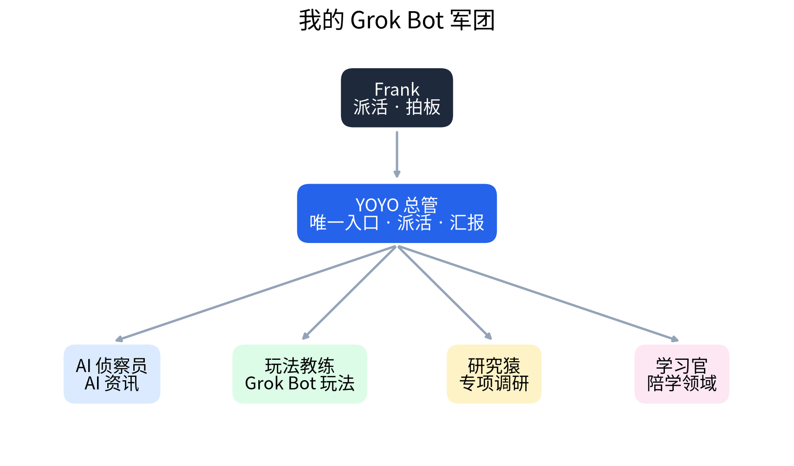
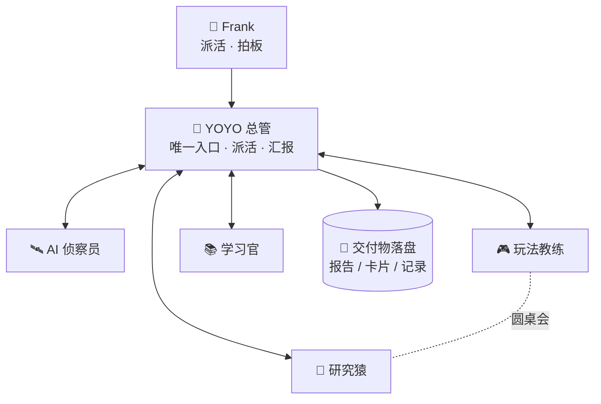

# 🤖 一个人 + 5 个 AI Bot：我用 Grok Bot 搭了一支会自己分工的 AI 团队

> 我只跟一个"总管"说话，剩下的找资讯、研究玩法、做调研、陪我学习，由 Bot 们自己派活、自己同步、自己交付。
> 这是 **Frank** 的多智能体协作实践记录，从 Day 1 开始，如实记录，包括踩过的坑。

🌐 展示页：<https://940329540aaa-ui.github.io/grok-bot-squad/>

---

## 这是什么

基于 [Grok Bot](https://x.ai/bot) 搭建的 5 人 AI 团队。每个 Bot 有自己的云电脑、长期记忆和一张"职责卡"：

| Bot | 角色 | 一句话职责 |
|---|---|---|
| 🧭 **YOYO 总管** | 总控 | 我唯一的对话入口：拆任务、派活、验收、汇报 |
| 🛰️ **AI 侦察员** | 输入 | 搜集 X / GitHub / B 站 / YouTube 的 AI 动态，只读不写 |
| 🎮 **玩法教练** | 策略 | 搜罗社区玩法，按我的实际条件过滤成可落地步骤 |
| 🔬 **研究猿** | 调研 | 点名才开工，追一手来源，写结论先行的短报 |
| 📚 **学习官** | 学习 | 一问一答带我学透一个领域，沉淀学习卡片 |

职责卡全文见 [`bots/`](bots/)。

## 架构

## 设计原则

1. **单一入口**：人只跟总管说话。Bot 一多，人脑记不住谁负责什么。
2. **职责卡**：每个 Bot 写明「只干什么 / 坚决不干什么 / 交付标准」，派活不用猜，Bot 之间不抢活。
3. **Bot 直接同步，人不当传话筒**：Bot 之间直接发消息，做完统一由总管汇报。
4. **交付物落盘**：长内容一律存成文件，对话里只放结论和链接。
5. **人在关键节点拍板**：新建 Bot、发信、删除、付费、对外发布，必须先经我同意。
6. **省额度铁律**（试用额度按实际工作量计费）：
   - 定时任务每天 ≤ 2 次，能用事件触发就不用轮询
   - 尽量不用浏览器，能走命令行就走命令行
   - 派活一次说清，结果一次收回，不来回确认
   - 来源：[Grok Bot 套餐说明](https://prod.cursor.com/help/grok-bot/plans) · [Grok Bot Wiki：每周额度](https://www.grokbotwiki.com/guides/grok-bot-weekly-usage-limit)

## 案例（Day 1 搭建日志）

### 案例 1：Bot 圆桌会 —— 试用到期要不要付费？

让两个 Bot 站在不同立场独立作答，总管裁决：

- **玩法教练（价值方）**：付费的独有价值是多 Bot 长期记忆 + 互相派活、持久云电脑能装命令行工具、定时任务 + 专属邮箱让 Bot 离线干活。如果只是聊天，普通聊天订阅就够了。
- **研究猿（事实方）**：官方未公布各档具体额度；按周给、每周重置；可以设按量付费月上限；定价页只写了信用卡/借记卡；取消政策未写明。
- **总管裁决**：**现在不付费，用满试用期，看数据再定。** 付费的 3 个信号：
  1. 至少 1 个定时任务的结果，我每天真的会看
  2. Bot 之间直接派活，至少替我省掉 3 次手动转发
  3. 每天额度用量在 10% 左右以内

  第 6 天自动复盘；若付费，先买最低档月付，按量付费上限设 $0。

👉 这套流程已沉淀成可复用技能：[`skills/bot-roundtable.md`](skills/bot-roundtable.md)

### 案例 2：从浏览器受限到命令行绕行

云电脑上的浏览器网络通道时好时坏，B 站、YouTube、GitHub 全都打不开。但命令行一直正常，于是：

- 用命令行抓取 GitHub Trending，挑出当天的 AI 相关项目
- 写一段 Python 脚本把数据画成图表
- 结果照样交付，而不是一句"做不了"

**收获**：给 Agent 留一条不依赖 GUI 的备用路线，可靠性高很多，还更省额度。

### 案例 3：参考社区玩法，再做减法

研读了 [@Jackywxsz](https://x.com/Jackywxsz/status/2108808842045956343) 开源的 12 个 Bot"内容军团"。它是为自媒体生产设计的，我没有照搬：

- 总控岗：我的 YOYO 已经在做
- 资讯岗：和 AI 侦察员重复
- 只取 **研究猿** 和 **学习官** 两个岗位，按公开职责介绍自己重建

再结合 [@qzcanoe](https://x.com/qzcanoe/status/2108836178673959249) 的观点「**少开 Bot，多装技能**」：只有需要并行、需要隔离上下文时才开新 Bot，其余用 Skill 补。所以"圆桌会"做成了技能，而不是又一个 Bot。

### 案例 4：踩坑与反思

| 坑 | 怎么处理 |
|---|---|
| 小红书、闲鱼、B 站搜索会触发风控 | 改用公开榜单、官方 API 或命令行，不硬刚 |
| X 官方 API 部分能力需付费 | 只用可用的公开数据接口，读不到正文就如实说明 |
| 浏览器网络通道不稳定 | 命令行优先；浏览器检测从每小时 2 次降到每天 2 次 |
| 总管**自作主张**做了一个我不需要的每日资讯网站 | 停掉定时任务、下线仓库，并定下规则：**新建任何东西前先问我** |

完整时间线：[`logs/2026-10-10.md`](logs/2026-10-10.md)

## 已沉淀的技能

- **Bot 圆桌会**：提案方 + 质疑方各自独立作答一次，总管裁决、落盘、定复盘时间。[查看](skills/bot-roundtable.md)

## Roadmap

- [ ] **邮件派活入口**：手机发一封邮件给总管，自动拆分派活，回一封汇总邮件（只接受白名单发件人）
- [ ] **接力审稿 + 额度账本**：一个 Bot 出活、另一个抽查，每天记额度账，第 7 天出「哪些活值得付费」报告
- [ ] **微信接入**：需要贴密钥并扫码，**待安全审查**后再决定

## 致谢 / 灵感来源

- [@affnom_y](https://x.com/affnom_y/status/2098989864855519306)：主 Bot 当 CEO
- [@eze_is_1](https://x.com/eze_is_1/status/2108850702600847375)：Webhook 多 Bot 派活
- [@Jackywxsz](https://x.com/Jackywxsz/status/2108808842045956343)：Grok Bot 内容军团
- [@qzcanoe](https://x.com/qzcanoe/status/2108836178673959249)：少开 Bot 多装技能
- [@LawrenceW_Zen](https://x.com/LawrenceW_Zen/status/2108825552379687326)：微信接入
- [@shuziyoumin_vip](https://x.com/shuziyoumin_vip/status/2108838833685192986)：Bot 专属邮箱

---

⚡ Built with Grok Bot · 本仓库由 Frank 的 Bot 团队协作整理，内容经人工拍板后发布
